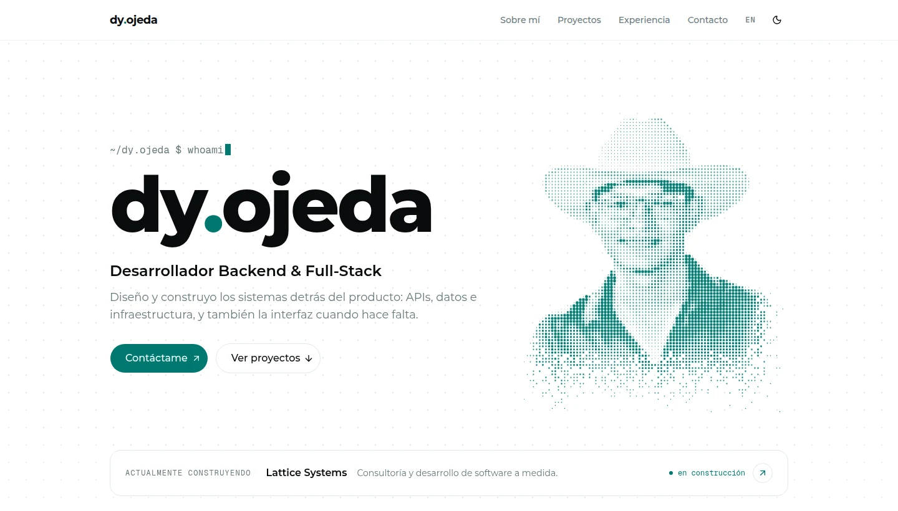

<div align="center">

# dy.ojeda

Portafolio personal de **Daniel Ojeda**, desarrollador Backend & Full-Stack en León, Guanajuato.

**[dyojeda.tech](https://dyojeda.tech)** · [LinkedIn](https://www.linkedin.com/in/daniel-ojeda-luna-215082301) · [Lattice Systems](https://latticesystems.dev)

<picture>
  <source media="(prefers-color-scheme: dark)" srcset="docs/preview-dark.webp" />
  
</picture>

</div>

## Qué es

Un sitio de una sola página, en español e inglés, que cuenta quién soy, qué he construido y cómo contactarme: proyectos, experiencia, stack y Lattice Systems, la consultoría que estoy empezando. Todo el contenido es real; no hay métricas ni clientes inventados.

## Detalles

- **Retrato de puntos.** Mi foto, sin fondo, se redibuja en un `<canvas>` como una retícula de puntos: se arma de abajo hacia arriba, la recorre un barrido periódico y los puntos se apartan del cursor. Los bordes se disuelven en el fondo en lugar de cortarse.
- **Campo de puntos en toda la página.** Una retícula fija con paralaje que se ilumina en teal alrededor del puntero.
- **Tarjeta de Lattice Systems.** Un grafo de nodos (literalmente un *lattice*) por el que viajan pulsos como señales entre servicios; los nodos cercanos al cursor se atraen y se encienden.
- **Coreografía con GSAP.** Cada sección entra con su propio gesto (texto que sube desde un desenfoque, proyectos que se destapan con `clip-path`, una línea de tiempo que se dibuja con el scroll, rutas de terminal que se teclean solas), y el scroll tiene inercia con Lenis.
- **Bilingüe de origen.** Rutas `/es` y `/en`, con redirección según `Accept-Language` y enlaces `hreflang`.
- **Tema claro y oscuro** sin parpadeo: se aplica antes del primer pintado.
- **Accesible.** Con `prefers-reduced-motion` se desactivan las animaciones y el sitio queda completo y estático.

## Stack

| | |
|---|---|
| Framework | [Next.js 16](https://nextjs.org) (App Router, Cache Components) y React 19 |
| Estilos | [Tailwind CSS v4](https://tailwindcss.com) (configuración solo en CSS) y [shadcn/ui](https://ui.shadcn.com) sobre [Base UI](https://base-ui.com) |
| Movimiento | [GSAP](https://gsap.com) (ScrollTrigger, SplitText) y [Lenis](https://lenis.darkroom.engineering) |
| Íconos | [lucide](https://lucide.dev) y [Simple Icons](https://simpleicons.org) para los logos de tecnologías |
| Tipografía | Montserrat y Geist Mono vía `next/font` |
| Despliegue | [Vercel](https://vercel.com) |

## Correrlo en local

Requiere Node.js 20.9 o superior y [pnpm](https://pnpm.io) (la versión está fijada en `packageManager`, así que `corepack enable` basta).

```bash
pnpm install
pnpm dev
```

Abre [http://localhost:3000](http://localhost:3000); te redirige a `/es` o `/en` según el idioma de tu navegador.

| Comando | Qué hace |
|---|---|
| `pnpm dev` | Servidor de desarrollo |
| `pnpm build` | Build de producción |
| `pnpm start` | Sirve el build de producción |
| `pnpm lint` | ESLint |

## Estructura

```
app/
├── [lang]/
│   ├── layout.tsx          Layout raíz por idioma: fuentes, metadatos y script de tema
│   ├── page.tsx            La página completa, sección por sección
│   ├── dictionaries/       Todo el texto: es.ts (fuente) y en.ts (tipado contra es)
│   └── dictionaries.ts     Idiomas soportados y enlaces compartidos
├── globals.css             Tokens de color, tema oscuro y utilidades propias
└── favicon.ico, icon.png, apple-icon.png
components/
├── site/                   Componentes del sitio
│   ├── page-motion.tsx     Coreografía GSAP, dirigida por atributos data-*
│   ├── smooth-scroll.tsx   Lenis conectado al ticker de GSAP
│   ├── dot-portrait.tsx    Retrato de puntos (canvas)
│   ├── dot-field.tsx       Campo de puntos de fondo (canvas)
│   ├── lattice-graph.tsx   Grafo de la tarjeta de Lattice (canvas)
│   └── tech-icon.tsx       Nombre de tecnología → logo
└── ui/                     Componentes de shadcn/ui
lib/gsap.ts                 Registro único de plugins de GSAP
proxy.ts                    Redirección por idioma
public/retrato.png          Foto recortada sin fondo que alimenta el retrato
```

## Editar el contenido

- **Textos:** `app/[lang]/dictionaries/es.ts` y `en.ts`. El inglés está tipado contra el español, así que TypeScript avisa si falta una traducción.
- **Enlaces** (GitHub, LinkedIn, Instagram, Lattice): `app/[lang]/dictionaries.ts`.
- **Una tecnología nueva** en el stack o en un proyecto: agrégala al mapa de `components/site/tech-icon.tsx` para que tenga logo.
- **Retrato:** reemplaza `public/retrato.png` por otra foto con fondo transparente.

Las reglas visuales (colores, tipografía, espaciado, movimiento) están en [`DESIGN.md`](DESIGN.md), y el propósito y la audiencia del sitio en [`PRODUCT.md`](PRODUCT.md).

## Contacto

¿Un puesto, un proyecto o una idea? Escríbeme a **[danielojeda.dev@outlook.com](mailto:danielojeda.dev@outlook.com)**.

---

<sub>El código está aquí como referencia. Los textos, la foto y la marca dy.ojeda son personales.</sub>
